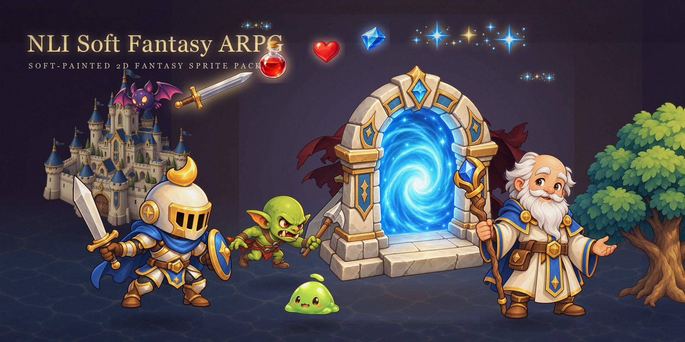

# Soft Fantasy ARPG Assets

**NLI Soft Fantasy ARPG** — a warm, soft-glow fantasy ARPG sprite pack for Unity. 224 static sprites with transparency, each paired with a ready-to-use static Prefab.



- **Version:** 0.2.1
- **Sprites:** 224 PNG (219 individually redrawn, 4 approved originals preserved byte-for-byte, 1 new NPC — the Elder)
- **Style:** `NL-ARPG-SOFT-766DF2B7` — warm, soft-painted fantasy
- **Compatibility:** Unity 2022.3 / Unity 6.0 (editor tools target these APIs)

**[📦 Open the icon preview](preview.html)** — a standalone, offline icon browser for all 224 sprites: search, category filter, light/dark/checkerboard backgrounds, and full-size viewing. No server needed; just open it from a clone of this repo.

An additional in-pack catalog with old-vs-new comparisons is available at [`Assets/NLI_SoftFantasy_ARPG/Previews/Asset_Catalog.html`](Assets/NLI_SoftFantasy_ARPG/Previews/Asset_Catalog.html) (Chinese UI).

## Pixel Fidelity

All final images are native generated PNGs. Original pixels **and alpha channels are preserved** — no upsampling, no background removal, no re-cropping, no non-power-of-two scaling. Per-image native sizes are recorded in [`Assets/NLI_SoftFantasy_ARPG/Documentation/Asset_Manifest.json`](Assets/NLI_SoftFantasy_ARPG/Documentation/Asset_Manifest.json); do not assume a uniform canvas from filenames.

## Repository Layout

```
soft-fantasy-arpg-assets/
├─ preview.html                  # Icon preview (English) — offline, search & category filter
├─ README.md                     # English guide (this file)
├─ README_START_HERE.md          # Chinese quick-start
├─ Tools/                        # Maintenance scripts
└─ Assets/
   └─ NLI_SoftFantasy_ARPG/      # Unity package root — copy this folder (with its .meta) into your project
      ├─ Sprites/                # ★ 224 final sprites — the asset source folder
      ├─ Prefabs/                # 224 static SpriteRenderer prefabs (mirrors Sprites/)
      ├─ Source/
      │  ├─ Generated/           # (local only, not in git) byte-identical copies of Sprites/
      │  └─ Legacy_Sprites/      # 219 legacy images, kept for side-by-side comparison
      ├─ Source_Crops/           # Legacy design-reference crops
      ├─ Documentation/          # Manifest, asset index, 220 generation records + prompts
      ├─ Previews/               # In-pack catalog (Chinese, old-vs-new compare)
      ├─ Reference_Panels/       # Per-category contact sheets
      ├─ Style/                  # Style card (NL-ARPG-SOFT-766DF2B7)
      └─ Editor/                 # Optional Unity editor browser (Tools menu)
```

`Sprites/` is the primary asset source folder; everything the pack ships for game use is either in it or mirrors it (`Prefabs/`, and the untracked `Source/Generated/` copies).

### Sprite Categories

| Category | Count |
|---|---|
| Environment (terrain, nature, buildings) | 72 |
| Items | 39 |
| Characters | 32 |
| Enemies | 28 |
| UI | 27 |
| VFX | 22 |
| Boss | 4 |
| **Total** | **224** |

## Unity Usage

1. Copy the `Assets/NLI_SoftFantasy_ARPG` folder and its sibling `.meta` file into your project's `Assets/` directory.
2. Sprite and Prefab GUIDs from the previous version are preserved — treat this as an in-place upgrade of the same asset pack, not a fresh import.
3. Import defaults: 100 PPU, center pivot, Bilinear, Clamp, no compression.
4. Optional editor menu: **Tools → NLI Soft Fantasy → Open Asset Browser** (editor-only; no runtime, URP, or third-party dependencies).

Actual in-game display scale and ground/foot anchor points still need calibration in your project.

## Known Limitations

- Characters and enemies are **independent static poses** — not calibrated as continuous animations.
- Terrain samples are **not yet validated for seamless tiling**.
- Prefabs contain no colliders, AI, Animators, or game logic.
- The castle Small/Medium/Large set represents construction tiers; world sizes are not yet unified.
- Soft, semi-transparent pixels are fully preserved; terrain solid surfaces may be opaque.
- File validation is not a substitute for an actual Unity Editor import test.

See [`KNOWN_LIMITATIONS.md`](Assets/NLI_SoftFantasy_ARPG/Documentation/KNOWN_LIMITATIONS.md) and [`PROVENANCE.md`](Assets/NLI_SoftFantasy_ARPG/Documentation/PROVENANCE.md) for details.

## Provenance

Every asset is AI-generated (built-in `image_gen`), and each of the 220 generation records — prompts, reference images, original output paths, hashes, sizes, and visual review notes — is archived under `Documentation/Generation_Records/`. The 4 approved originals plus the NPC Elder have their prompts under `Documentation/Generation_Prompts/`.

> **Note:** `Source/Generated/` (the byte-identical generated-source copies of `Sprites/`, MD5-verified) is kept locally but not tracked in git — see `.gitignore`. The records' `Source/Generated/...` output paths therefore refer to files that exist in the original pack but not in this repository.

This repository contains **art assets only** — no PyQuest game runtime code was modified.

## Changelog

- **0.2.1** (2026-10-28) — Added NPC Elder (`Sprites/Characters/NPCs/NPC_Elder.png`, 1254×1254, single static standing pose: cream robe, blue-gold shoulder cape, white beard, wooden staff).
- **0.2.0** — Full redraw of 219 legacy assets; 4 approved originals retained.

## Dungeon module kit + walking-cycle test

[Open the interactive prototype](Prototypes/DungeonWalk/index.html): three layouts assembled from 8 independent dungeon modules, plus a calibrated east-facing six-frame walk cycle. Includes collision-grid inspection, crate/plate gate test, pause/step/FPS and light/dark/checker backgrounds. [Kit guide and limitations](Assets/NLI_Prototype_Kit/README.md). The 224-sprite base pack remains unchanged.

The dungeon prototype HTML now embeds all required images, so it can be copied and opened on its own. Run `npm run build:preview` after changing its source/manifest; `npm run test:kit` verifies both a full checkout and preview-only hosting.
